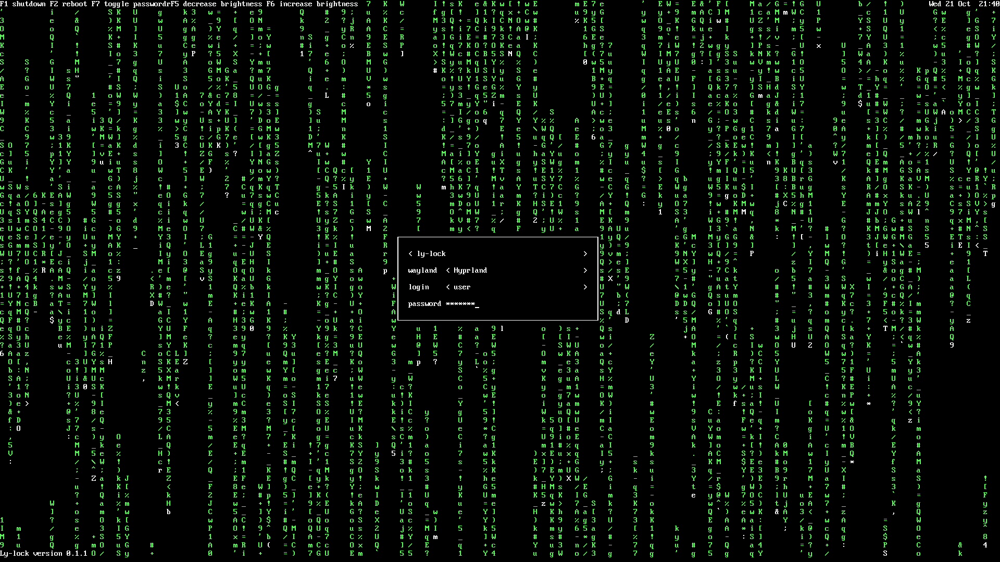
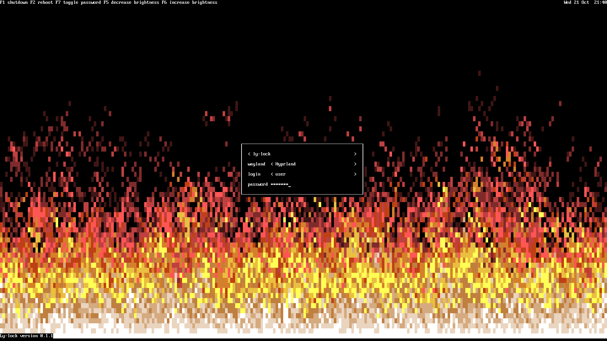
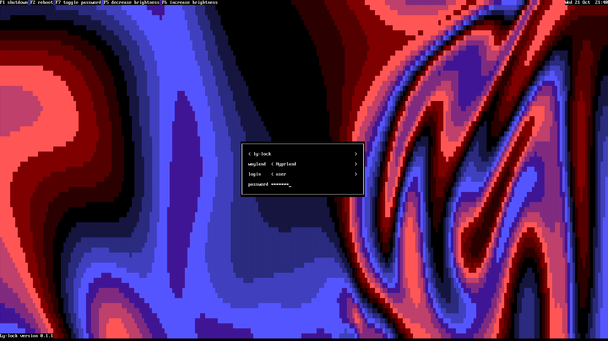
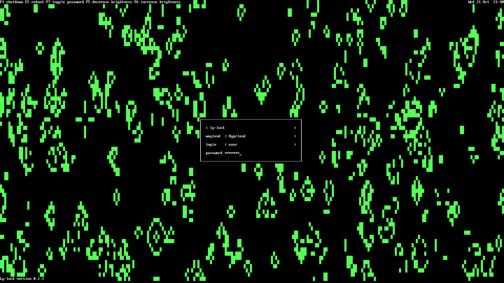
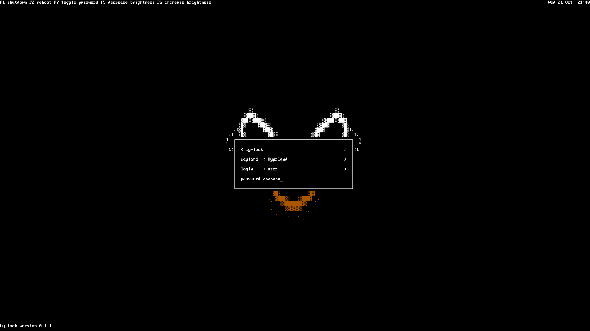
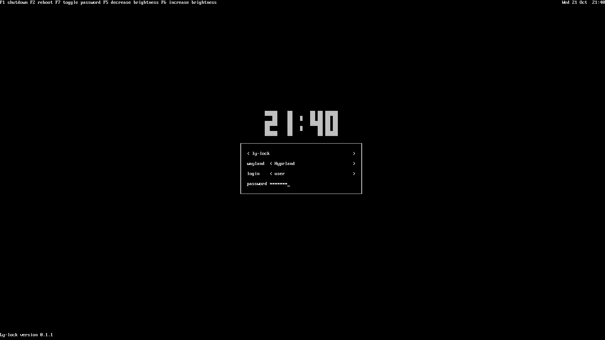

# ly-lock

A Wayland lock screen that is [ly](https://codeberg.org/fairyglade/ly)'s login screen.

ly-lock reads ly's own `config.ini` and draws exactly what ly would draw on your tty: the animation, the key hints, the clock and the box. Lock your session and it looks like you logged out to ly.

ly-lock is not part of ly and is not affiliated with its authors.

## Screenshots

Each background is chosen with `animation` in ly's config.

| `matrix` | `doom` |
| :---: | :---: |
|  |  |
| `colormix` | `gameoflife` |
|  |  |
| `dur_file` (ly's example movie) | `none`, with `bigclock = en` |
|  |  |

## What it copies from ly

- All six backgrounds: `matrix`, `doom`, `colormix`, `gameoflife`, `dur_file` and `none`, ported step by step from ly 1.4.1.
- The layout, labels and colors of every widget, read from your ly config and language file.
- The big clock, battery label, keyboard lock labels, custom `[lbl:]` labels and `[cmd:]` keys.
- The console look. ly-lock draws with your console font from `/etc/vconsole.conf` and maps colors the way the Linux console does. ly's green `0x00FF00` shows as the console's bright green, not as pure green.
- ly's keys: F1 powers off, F2 reboots, F5 and F6 change the brightness, F7 shows the password. Sleep and hibernate keys work when ly's config sets their commands.
- The failed-login cascade after `auth_fails` wrong passwords.

## Differences from ly

- The session and login rows are fixed. They show the session and user ly would preselect for you.
- Focus stays on the password row. Up, Down and Tab do nothing.
- F1 and F2 run `systemctl poweroff` and `systemctl reboot`. ly's own `shutdown_cmd` and `restart_cmd` usually need root.
- Ctrl+C does not quit.

## Requirements

- A compositor with `ext-session-lock-v1` (Hyprland, Sway, niri, river and others).
- GTK 4, gtk4-layer-shell 1.3 or newer, Python 3.10 or newer, PyGObject, NumPy, PyOpenGL and python-pam.
- A PAM service called `ly-lock`. The packages below install it.
- ly itself is optional. Without it ly-lock uses ly's defaults.

## Install

### NixOS

```nix
{
  inputs.ly-lock.url = "github:rugbedbugg/ly-lock";

  outputs = { nixpkgs, ly-lock, ... }: {
    nixosConfigurations.host = nixpkgs.lib.nixosSystem {
      modules = [
        ly-lock.nixosModules.default
        { programs.ly-lock.enable = true; }
      ];
    };
  };
}
```

The module installs ly-lock and its PAM service.

### Arch Linux

Install `ly-lock` from the AUR.

### From source

```sh
pip install .
sudo install -Dm644 pam/ly-lock /etc/pam.d/ly-lock
```

## Use

Run `ly-lock` to lock the session. To lock from hypridle:

```ini
general {
    lock_cmd = ly-lock
}
```

Options:

- `-c`, `--config FILE`: read a different ly config. The default is `/etc/ly/config.ini`.
- `--preview`: show the lock screen in a normal window without locking. Unlocking closes the window.

Environment:

- `LY_LOCK_FONT`: path to a PSF console font to use instead of the one in `/etc/vconsole.conf`.
- `LY_LOCK_RENDERER=cpu`: draw on the CPU instead of with OpenGL.

## If it crashes

The session stays locked. Your compositor decides how to recover. On Hyprland, switch to another tty, log in and run:

```sh
hyprctl --instance 0 'keyword misc:allow_session_lock_restore 1'
hyprctl --instance 0 'dispatch exec ly-lock'
```

## Development

```sh
nix develop
pytest
ly-lock --preview
```

To redraw the screenshots after a visual change, pass ly's `res/example.dur` for the `dur_file` shot:

```sh
python tools/screenshots.py docs/screenshots path/to/ly/res/example.dur
```

## License

[WTFPL](LICENSE), the same license as ly.
